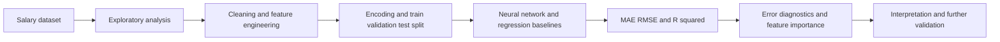
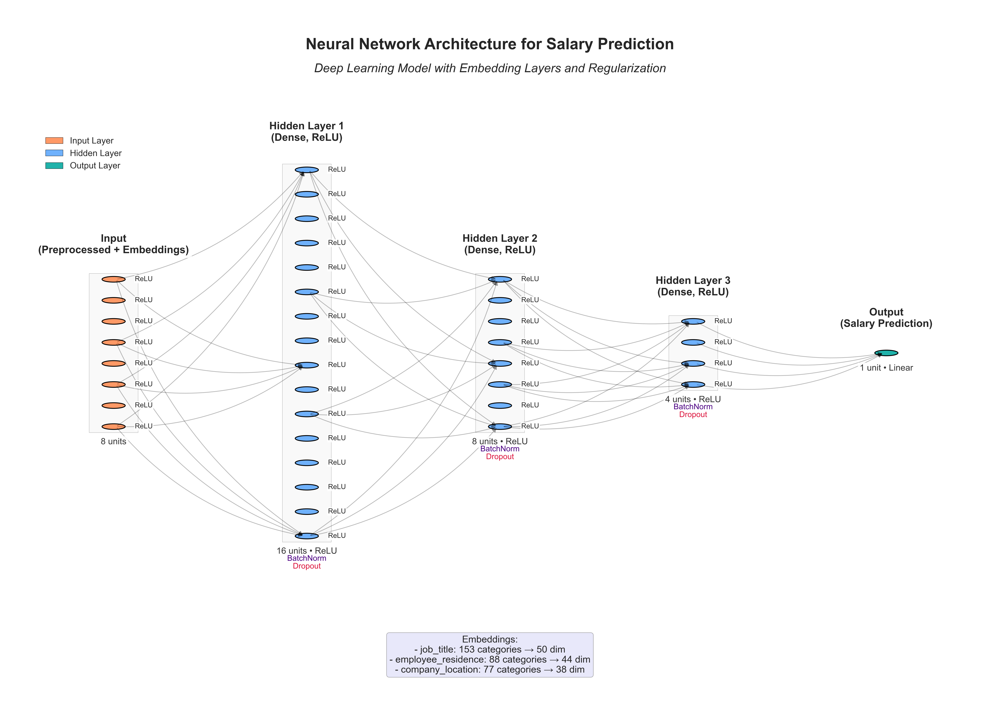

# Salary Prediction and Model Explainability

> An applied compensation analytics and machine learning project exploring how job characteristics relate to salaries and comparing neural networks with traditional regression methods.

**Status:** Research and modelling notebook with saved datasets, visualisation modules and a neural-network checkpoint. Reproducibility, leakage controls and final model metrics require validation.  
**Focus:** Salary analytics, exploratory data analysis, feature engineering, regression modelling, model comparison and explainability.

## Executive Summary

Compensation varies across experience levels, job titles, locations, employment arrangements, remote-work policies and organisations. This project investigates how these features relate to observed salaries in machine learning roles, then develops predictive models to estimate salary in US dollars.

The project combines descriptive analytics, a PyTorch feedforward neural network, traditional regression baselines and feature importance analysis. The notebook also describes SHAP explainability as an objective, but the present repository does not establish a complete, independently verified SHAP explanation workflow.

## Business Problem and Objectives

An analyst evaluating compensation data needs to understand salary distributions, compare roles and identify which attributes may help explain differences in pay. The project aims to:

1. Explore salary distributions, differences across categories and outliers.
2. Prepare a modelling dataset from job and employer characteristics.
3. Compare a neural-network approach with linear regression, random forest and XGBoost.
4. Evaluate prediction errors using MAE, RMSE and R².
5. Investigate feature importance and work toward trustworthy explanations of model outputs.

Predictions represent relationships in an observed dataset, not guaranteed salaries or recommended pay offers.

## Data

The repository includes `data.csv`, `df_clean.csv`, `df_features_combined.csv` and `df_features_encoded.csv`. The research notebook is `mlpaygradenotebook.ipynb`.

The notebook analyses attributes including job title, experience level, employment type, employee residence, company location, company size, remote-work ratio and salary in USD. Dataset provenance, licensing, coverage period and sampling limitations should be documented explicitly before external reliance.

| Category | Example fields | Analytical role |
| --- | --- | --- |
| Position and seniority | Job title, experience level | Career and role factors |
| Employment arrangement | Employment type, remote ratio | Work structure |
| Geography and employer | Residence, company location, company size | Contextual factors |
| Target | `salary_in_usd` | Continuous regression outcome |

## Architecture and Workflow



## Exploratory Analytics

The notebook and supporting Python modules investigate salary distributions, outliers, experience levels, employment types, company locations, company size and remote work patterns. Modular plotting scripts support several of these comparisons.

## Feature Engineering and Data Preparation

The workflow explores categorical encoding, numerical transformations and saved intermediate datasets. It includes a train/validation/test preparation stage for deep learning.

**Critical validation issue:** The notebook creates salary-derived variables such as `salary_log`, `salary_squared` and `salary_bracket` from the target `salary_in_usd`. If any of these are used as predictors, they cause target leakage and invalidate predictive evaluation. Confirm they are excluded from all feature matrices before relying on any scores. Also fit encoding and scaling on training data alone.

## Model Development

### Neural network

The notebook contains a PyTorch feedforward regression network, training loop, early stopping and checkpoint handling. A checkpoint is committed as `model_checkpoints/best_model.pth`. The repository includes a network architecture illustration:



### Baseline model comparison

The notebook contains model comparison code for linear regression, random forest, XGBoost and a feedforward neural network. It also includes MLflow experiment logging code.

| Model | Implementation evidence | Results status |
| --- | --- | --- |
| Linear regression | Notebook training and evaluation code | Reproduction required |
| Random forest regression | Notebook training and evaluation code | Reproduction required |
| XGBoost regression | Notebook training and evaluation code | Reproduction required |
| PyTorch neural network | Notebook code and saved checkpoint | Reproduction required |

**Evaluation metrics:** MAE and RMSE describe error in monetary units when predictions and targets are on the original salary scale. R² indicates how much variation is explained relative to a mean-only baseline. Report values only after confirming data splits, scaling, inverse transformations and leakage safeguards.

## Explainability

The current notebook includes XGBoost's built-in feature importance analysis and identifies SHAP as a project objective. **Built-in feature importance is not the same as SHAP.** A verified SHAP analysis should specify the explainer, the exact fitted model, held-out samples and global or local contribution plots before making SHAP-based claims.

## Repository Structure

```text
README.md
mlpaygradenotebook.ipynb
solution.ipynb
data.csv
df_clean.csv
df_features_combined.csv
df_features_encoded.csv
model_checkpoints/
    best_model.pth
neural_network_architecture_improved.png
neural_network_architecture_improved.svg
requirements.txt
*_plot_module.py
employment_analysis.py
job_exp_analysis.py
docs/
    legacy-readme.md
```

Additional `__pycache__/` files are present in the repository. These compiled Python files are normally excluded from version control.

## Getting Started

```bash
git clone https://github.com/TeslimAdeyanju/Salary-Prediction-SHAP.git
cd Salary-Prediction-SHAP
python3 -m venv .venv
source .venv/bin/activate
python -m pip install -r requirements.txt
jupyter notebook mlpaygradenotebook.ipynb
```

These commands launch the research environment but do **not** guarantee clean notebook execution. The existing requirements file is a broad pinned environment export; the notebook also imports PyTorch, XGBoost and MLflow, which require explicit dependency verification. A minimal reproducible environment and tested execution instructions remain to be created.

## Limitations and Next Steps

1. Remove all target-derived predictors and rerun model comparisons to rule out leakage.
2. Validate preprocessing independently on training and held-out datasets.
3. Reproduce and publish numerical model results and error distribution plots.
4. Implement and validate SHAP explanations before describing SHAP as completed.
5. Reconcile required packages, Python version and checkpoint loading.
6. Document dataset provenance, geographic representation and potential pay-related biases.
7. Remove tracked Python bytecode and add appropriate ignore rules.
8. Add a tested inference example or application only after the model is validated.

## Responsible Use

Observed salary data may reflect geographic differences, sampling effects and historical pay inequities. The outputs should not be used as the sole basis for compensation or employment decisions.

## Author

**Teslim Adeyanju**  
[GitHub](https://github.com/TeslimAdeyanju) | [Portfolio](https://adeyanjuteslim.co.uk) | [LinkedIn](https://www.linkedin.com/in/adeyanjuteslimuthman)

[Original README archive](docs/legacy-readme.md)
